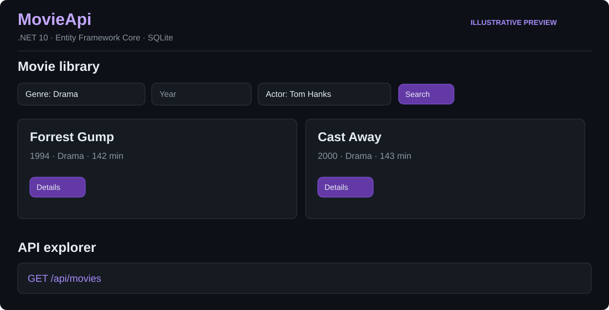
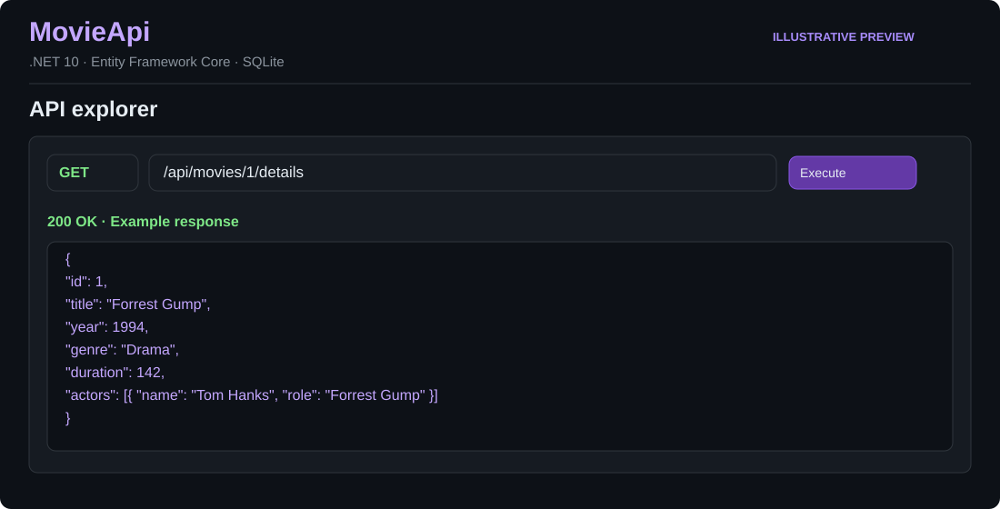
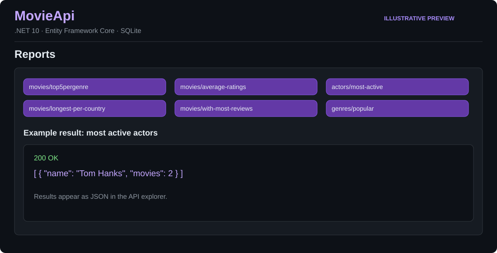
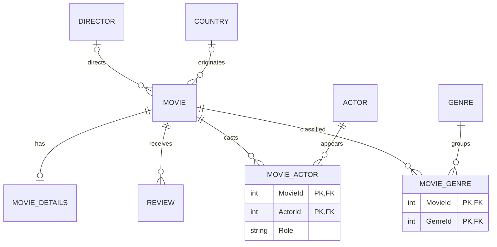

<div align="center">

# 🎬 MovieApi

**A dark-mode movie library and REST API**


Övning 3 — Movie API med EF Core

</div>

## 📖 Overview

MovieApi demonstrates controller-based ASP.NET Core REST endpoints, relational data modeling, manual DTO mapping, LINQ queries and validation. The local dark-mode interface provides movie filtering, a JSON API explorer and access to statistical reports.

## 🖼️ Interface previews

These SVG illustrations are based on the implemented HTML interface and seed data. They are **not runtime screenshots**; actual rendering and API responses have not yet been verified.

### 🎞️ Movie library


### ⚡ API explorer


### 📊 Reports


## ✨ Features

| Feature | Description |
|---|---|
| 🎬 Movies | Create, read, update and delete movies |
| 🎭 Actors | CRUD and movie associations with character roles |
| ⭐ Reviews | Create, list and delete reviews; ratings 1–5 |
| 📝 Details | Synopsis, language, budget, cast and reviews |
| 🔎 Filtering | Genre, year and actor name |
| 🌍 Metadata | Directors, countries and multiple genres |
| 📈 Reports | Six LINQ-based statistics endpoints |
| 🛡️ Validation | Data annotations and automatic HTTP 400 |
| 🌙 Interface | GitHub-inspired dark mode with purple accents |
| 📚 Documentation | OpenAPI JSON specification |

## 🚀 Getting started

Install the .NET 10 SDK, then run:

```bash
git clone https://github.com/1x4x/21-walter-movieapi.git
cd 21-walter-movieapi
dotnet restore
dotnet run --urls http://localhost:5080
```

| Resource | URL |
|---|---|
| 🌐 Website | http://localhost:5080 |
| 📄 OpenAPI | http://localhost:5080/openapi/v1.json |
| 🎬 Movies | http://localhost:5080/api/movies |

SQLite uses `movies.db` by default. Startup applies the baseline migration and seeds demo movies, actors, reviews, details, directors, genres and countries.

## 🗄️ Entity relationships



The original Genre string is retained alongside the normalized genre relationship for compatibility with the exercise. Director and Country are optional foreign keys in this implementation.

## 📁 Project structure

```text
MovieApi/
├── Controllers/     # Movies, Actors, Reviews, Reports
├── Data/            # MovieContext and Fluent API
├── DTOs/            # Request validation and response models
├── Extensions/      # SeedData extension
├── Migrations/      # SQLite baseline migration
├── Models/          # Entities and relationships
├── wwwroot/         # Dark-mode HTML interface
├── docs/screenshots/# Illustrative SVG previews
├── Program.cs
└── MovieApi.csproj
```

## 📡 REST endpoints

| Method | Endpoint | Purpose |
|---|---|---|
| GET | /api/movies | List/filter movies |
| GET | /api/movies/{id} | Movie summary |
| GET | /api/movies/{id}/details | Full details |
| POST | /api/movies | Create movie |
| PUT | /api/movies/{id} | Update movie |
| DELETE | /api/movies/{id} | Delete movie |
| GET | /api/actors | List actors |
| GET | /api/actors/{id} | Actor |
| POST | /api/actors | Create actor |
| PUT | /api/actors/{id} | Update actor |
| DELETE | /api/actors/{id} | Delete actor |
| POST | /api/movies/{movieId}/actors | Link actor with role |
| POST | /api/movies/{movieId}/actors/{actorId}?role=Lead | Link actor via route |
| GET | /api/movies/{movieId}/reviews | List reviews |
| POST | /api/movies/{movieId}/reviews | Create review |
| GET | /api/reviews/{id} | Review |
| DELETE | /api/reviews/{id} | Delete review |

### 🔍 Filtering examples

```http
GET /api/movies?genre=Drama&year=1994
GET /api/movies?actor=Tom+Hanks
GET /api/movies/1?withactors=true
```

### ➕ Create a movie

POST /api/movies

```json
{
  "title": "Example movie",
  "year": 2026,
  "genre": "Drama",
  "duration": 110
}
```

### 🎭 Assign an actor

POST /api/movies/1/actors

```json
{"actorId": 1, "role": "Lead"}
```

### ⭐ Add a review

POST /api/movies/1/reviews

```json
{"reviewerName": "Alex", "comment": "Great film!", "rating": 5}
```

## 📊 LINQ reports

All routes below use the prefix `/api/reports/`.

| Route | Description |
|---|---|
| movies/top5pergenre | Top five rated movies per genre |
| movies/average-ratings | Average review rating by genre |
| actors/most-active | Actors ranked by movie count |
| movies/longest-per-country | Longest movie per country |
| movies/with-most-reviews | Movie with most reviews |
| genres/popular | Genres ranked by movie count |

## 🧪 Validation and Postman checks

| Test | Expected status |
|---|---|
| GET movies | 200 OK |
| POST valid movie | 201 Created |
| POST movie with duration 0 | 400 Bad Request |
| GET missing ID | 404 Not Found |
| DELETE existing movie | 204 No Content |
| POST review with rating 6 | 400 Bad Request |
| Duplicate actor association | 409 Conflict |

These are suggested manual checks, not recorded test results.

## 🛠️ EF Core Power Tools

In Visual Studio, open Extensions → Manage Extensions and install EF Core Power Tools. Close Visual Studio to finish installation. In Visual Studio Installer → Modify → Individual components, install DGML Editor if available. Reopen Visual Studio, right-click the project and select Add DbContext Diagram.

## ⚠️ Migration and verification notes

The baseline is manually authored, not generated by Visual Studio scaffolding. A generated model snapshot is missing and pending-model warnings are suppressed in Program.cs. On a fresh disposable database, remove the baseline migration and warning suppression, install the matching EF tool, and generate a new migration:

```bash
dotnet tool install --global dotnet-ef --version 10.0.0
dotnet ef migrations add InitialCreate
dotnet ef database update
```

Do not replace migration history on an existing database without a migration plan. The classroom requirement of separate migrations for each relationship and a Git commit before scaffolding must be reproduced locally. Compilation and runtime testing remain unverified. Reports aggregate in memory for the small demo dataset. The anonymous API is intended for local development, not public production deployment.

---

<div align="center">🎬 Built with C# · ASP.NET Core · Entity Framework Core</div>
